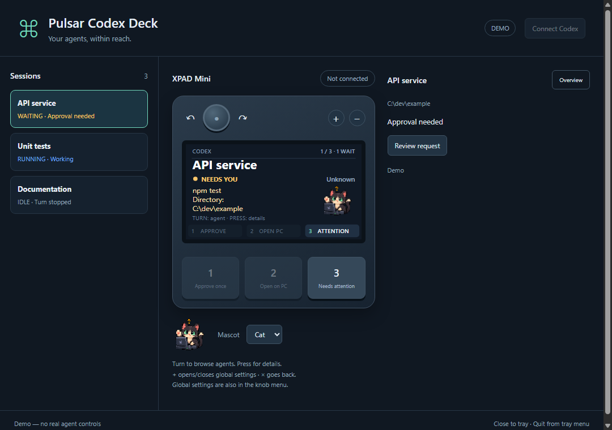

# Pulsar Codex Deck

[](https://github.com/peterpbroere/pulsar-codex-controller/actions/workflows/ci.yml)
[](https://github.com/peterpbroere/pulsar-codex-controller/releases)
[](LICENSE)

Turn a **Pulsar Lab XPAD Mini** into a physical controller for your Codex agents.
Browse agents with the knob, see what needs attention on the LCD, and approve
the selected request with a single key press.

**Windows x64 · public preview · no custom firmware required**

### Desk companions

Choose **Cat**, **Owl**, or **Off** using the PC app's Mascot selector, or press
**+ → Mascot** on the pad and press the knob to cycle the choices. Your choice
is saved automatically. Both original pixel-art companions animate while an
agent works, waits for input, rests, or reports an error. After an observed turn
ends, a short finish animation plays before the companion rests.

The mascot sits beside the activity preview. Press the knob for full details;
choose Off for the wider text preview. Colors and approval controls still show
the actual agent state independently of the animation.

### Model and Effort

The pad's top line shows the selected agent's **Model · Effort**. Both values
also appear beneath the agent's name in the PC app.

To change the pair on the pad: **press the knob → Model & Effort → choose a
model → choose its Effort → review both → press to apply**. Turn the knob to
browse and press to advance. × goes back one step; from the model list it
cancels the flow. The PC app's Model & Effort button opens the same flow.

Choices come from Codex's model catalog, including each model's supported
Effort values. The Effort step initially highlights your current value when
supported, otherwise the selected model's default; choose any supported value.
No settings are sent until you confirm the complete pair. Changes apply to subsequent turns
on that agent. Permission settings are preserved. If settings or model choices
change while a selection is being reviewed, reopen the selector to review it again.



*Demo screenshot with synthetic sessions. The physical LCD uses the same layout.*

### ComfyUI connections

Click **+ Add ComfyUI connection** in the PC app and enter a **Name** and the
instance's **Server URL** (for example, `http://127.0.0.1:8188`). Test the
connection, then save. Add another connection for each separate server: an AMD
instance and an NVIDIA instance can have their own names, URLs, queues and images.
Up to eight connections are supported, including servers on your local network.
The URL can include a reverse-proxy path; authenticated servers are not supported
in this version. Connections are saved locally and reconnect automatically.

Turn the knob to browse ComfyUI entries alongside Codex agents. Each shows
whether it is idle, queued, generating, finished or failed, plus the
number of pending jobs. **Key 2** opens the selected ComfyUI server on the PC.
Offline ComfyUI connections are hidden from the pad and its entry count. They
reappear automatically when connected. If the selected connection goes offline,
the pad switches to an available entry. Offline connections remain in the PC
app; click one to edit its settings or remove the connection.
**Key 1** retains its approval meaning and has no action on ComfyUI entries.
**Key 3** includes ComfyUI failures in its attention cycle. Queued jobs do not
count as requests for human attention.

The latest completed image appears as a thumbnail on the pad and a larger image
in the PC app. **Press the knob → Latest image → press** for a larger pad view;
**×** returns to the overview. The PC app also has a **View image on pad** button.
Images are fitted without cropping and stay visible while another job runs.
The last image is retained in memory while offline and is available again when
the connection returns to the pad. A failed image download keeps the previous image. These
are completed results, rather than live intermediate sampling previews.

Queue and image monitoring use ComfyUI's built-in read-only HTTP endpoints;
no workflow changes or ComfyUI extension are required. Images are selected from
the latest 40 history entries, preferring saved output images over temporary
previews and showing the final image of a batch. PNG, JPEG, WebP, GIF, AVIF and
BMP image outputs are supported (animated files show their first frame).
Video-only workflows have status monitoring but no image preview.
History is held by ComfyUI: a fresh server with no history has no previous result
to retrieve. Thumbnails stay in memory for the current deck process.

For **live node and step progress**, edit the connection, expand **Live node and
step progress**, click **Install progress helper…**, and choose that instance's
ComfyUI folder containing `main.py` and `custom_nodes`. Restart ComfyUI afterward.
Repeat for other installations as needed. The bundled optional helper adds one
read-only status route and no workflow nodes or dependencies. It leaves browser
connections alone. ComfyUI normally sends detailed progress only to the client
that submitted the job, so a separate monitor needs this helper for those details.
Older versions without the progress registry provide the node name when available.
While generating, the pad shows **Total: …%** and **Current node name: …%**
under Generating. Total follows ComfyUI's completed/cached node count; the
second percentage tracks progress within the current node. Slim bars show both
values beside the latest-image thumbnail. These values are also in the PC panel.
The helper observes existing progress notifications and forwards them unchanged;
it does not change execution or browser client IDs. Update an older helper using
the same Install progress helper button, then restart ComfyUI when its queue is
finished. Missing progress is shown as **—** rather than a guessed percentage.

Use **Edit connection** or **Remove connection** in the selected entry's PC panel
to manage it. Removing an entry does not stop ComfyUI or change its queue. This
version monitors existing jobs; it does not launch or cancel generations.

## Download and get started

1. **[Download the latest Windows release](https://github.com/peterpbroere/pulsar-codex-controller/releases).**
   Choose `…-Setup.exe` for a per-user installer, or extract `…-Portable.zip`
   and run `Pulsar Codex Deck.exe`.
2. Connect your XPAD Mini by USB and open the app. Close Bibimbap or other
   software that is using the device.
3. Click **Connect Codex** to install the session-status hooks. Existing hooks
   are preserved and backed up. In Codex, run **`/hooks`**, review and trust the
   new hooks, then start/resume a session and **send a prompt**.

The Windows downloads include Electron, the session backend, and Python. You
do **not** need Node.js, Python, a Flipper Zero, or another source checkout to run
the packaged app. You do need an installed, signed-in **[Codex CLI](https://learn.chatgpt.com/docs/cli)**.
The app uses that existing Codex login; it does not need a separate API key.

The builds are currently **unsigned**. Windows may show an unknown-publisher
warning. Download from this repository's Releases page and compare the archive's
SHA256 hash with `SHA256SUMS.txt` from the same release.

## What you can do

- Browse one agent at a time with room for its name, state, activity, and pending request.
- See status at a glance through RGB lights, even when you are not reading the LCD.
- Approve a supported pending request once, using its exact live request ID.
- Open the selected Codex session on your PC without sending a new prompt.
- Jump to the next agent that needs attention.
- Inspect details, reject requests, interrupt a turn, or send a Continue prompt.
- Change the selected session's permission preset for subsequent turns.
- Adjust display brightness and switch status lighting on/off.
- Monitor multiple ComfyUI servers and view their latest generated images.

## Physical controls

| Control | Action |
| --- | --- |
| **Turn knob** | Previous/next agent; navigate a menu when one is open |
| **Press knob** | Open agent details; select an item or confirm a settings change |
| **Key 1** | Approve the selected agent's displayed request **once** |
| **Key 2** | Open the selected agent on PC |
| **Key 3** | Jump to the next waiting/error agent |
| **+** | Open global settings; press again to return to the previous screen |
| **×** | Back to the agent screen |

The three main keys keep the same purpose across the interface. Their labels
line up along the bottom of the LCD. Key 1 is dimmed when no supported approval
is available. Approval uses a normal press, without a hold or an extra dialog.

The desktop companion mirrors the LCD and has clickable knob, key, and +/×
controls. Closing its window leaves it running in the tray; choose **Quit** from
the tray menu to exit. The app does not start at login automatically.

### Status lighting

| Color | Meaning |
| --- | --- |
| **Amber** | At least one agent needs approval or an answer |
| **Red** | An agent reported an error |
| **Blue** | An agent is working |
| **Green** | No agent is waiting, running, or reporting an error |

Waiting takes priority over error, running, and idle states. Reported session
states are preserved; inactivity alone never closes or hides a session.
ComfyUI jobs that are running or queued also light blue; failed generations
contribute to red. An offline connection is shown on its entry and does not
count as a generation error or pending approval.

### Permission presets

| Mode | Approval behavior | Sandbox |
| --- | --- | --- |
| **Read-only** | Ask when additional permission is needed | Read-only |
| **Auto** | Ask when additional permission is needed | Workspace write; network disabled by default |
| **No prompts** | Do not ask for approval; blocked operations remain blocked | Workspace write; network disabled |
| **YOLO / Full access** | No approval prompts | Full access |

Changes affect the **selected agent's subsequent turns**. They do not change
other agents or an already-running command. The app shows a confirmation before
applying a preset and reads the effective settings back from Codex. Custom
policies are displayed as **Custom** rather than silently labeled Auto.

Permission changes can be constrained by Codex or organization policy. Full
access deliberately removes Codex's sandbox and approval prompts. These presets
are distinct from any other controller's automatic approval feature.

## Requirements and current coverage

- **Windows 10/11 x64.** Windows 11 has been tested with a real device.
- **Pulsar Lab XPAD Mini**, connected by USB: VID `3710`, PID `2507`, 240×135 LCD.
- An installed, signed-in Codex CLI with lifecycle hooks and the shared local
  app-server protocol, including `codex app-server proxy`.
- **Developed and tested with Codex CLI 0.165.0.** The shared-server and settings
  APIs are experimental; other versions may require changes.
- Hooks must be allowed by your policy and reviewed/trusted in Codex.

Session discovery uses lifecycle events. It does not scan every open window,
read terminal text, or automatically discover internal subagents. CLI sessions
must have loaded the hooks and reported an event; sending the first prompt is
the normal way to make a new session appear. Controls require the session to be
loaded on the shared local server. Desktop-app conversation navigation and
macOS/Linux hardware operation have not been independently validated.

Long approval previews are visibly truncated on the small LCD. The full request
preview remains available in the companion/on PC, and display truncation never
changes which request is approved. Structured questions and unsupported approval
types remain for you to answer in Codex.

### Hardware behavior

All device changes are **temporary RAM changes**. The app does not flash firmware
or send a Save command. An orderly Quit restores the original key/knob mappings.
Unplug/replug restores the device's saved configuration after a crash or forced
termination. RGB overrides can remain until a profile switch or reconnect.

All controls use **direct USB input**, including while a game captures keyboard
shortcuts. Main keys and the knob use unsolicited vendor events; +/× use raw
button state. The app temporarily suppresses the main keys' and knob's keyboard
output, so their original bindings do not also activate in the foreground app.
No global function-key shortcuts or injected approval keystrokes are used.

## Troubleshooting

**No sessions appear**

Use Connect Codex, review/trust the entries in `/hooks`, then start or resume a
CLI session and send a prompt. A session that was already open before setup may
need to reload its hooks. Check that your policy permits user-defined hooks.

**Sessions appear, but controls are unavailable**

Check `codex --version` and that `codex app-server proxy` is supported. The
session must be loaded on the same PC's shared local server. Old journal entries
can be visible without being controllable. Use Open on PC when available.

**An approval disappears before I can press key 1**

Another Codex client/controller may have resolved it. In particular, disable
automatic approval in any other Agent Deck/Flipper controller while testing
manual approval. Existing command approval rules can also allow an action
without presenting a prompt.

**Device not connected / input is unresponsive**

Use a USB data cable, close Bibimbap and other device clients, then reconnect the
pad. If an older version stops responding while a game has focus, update to
v0.1.3 or later for direct USB input. The protocol is unofficial and may
vary with firmware. Occasional raw-input read timeouts are logged and polling
continues; include reproducible symptoms when reporting a problem.

**Where are settings and hooks stored?**

- Packaged-app preferences/profile: `%APPDATA%\PulsarCodexDeck`.
- ComfyUI connection names and URLs: `comfyui.json` in that profile.
- Session event journal: `%LOCALAPPDATA%\PulsarCodexDeck\events.sqlite3`.
- If an existing Agent Deck journal is found, it is reused for compatibility.
- Codex hooks: `%CODEX_HOME%\hooks.json`, or `%USERPROFILE%\.codex\hooks.json`.
  Changes create timestamped `.pulsar-deck-….bak` backups beside the hook file.

No prompt transcripts, credentials, or telemetry are uploaded by this app.
Session summaries, project paths, and activity metadata are stored locally.

**Uninstalling**

The Windows uninstaller offers to remove only Pulsar's hook entries, preserving
other integrations and backing up the file. For a portable install, run this
from its extracted directory before deleting/moving it:

```powershell
.\resources\backend\PulsarBackend.exe uninstall-hooks --apply
```

Then quit the app and remove the extracted folder. Moving a portable install
requires reinstalling its hooks so Codex knows the new backend path. Silent
uninstall leaves hooks unchanged; remove them explicitly first if needed.

## Run or build from source

Development requires Node.js **22.12+**, Python **3.9+**, and Git. Packaged users
do not need these development tools.

```powershell
git clone https://github.com/peterpbroere/pulsar-codex-controller.git
cd pulsar-codex-controller
npm ci
npm run setup
npm start
```

`npm run setup` creates a local Python environment and installs the small backend
dependencies. It does not register hooks automatically. Use Connect Codex in the
app or preview and apply the hook setup explicitly:

```powershell
.venv\Scripts\python.exe python\adapter.py install-hooks
.venv\Scripts\python.exe python\adapter.py install-hooks --apply
```

Use `npm run demo` to explore the UI with synthetic sessions and no hardware or
real agent actions. Source preferences and local test artifacts stay in `work/`.

```powershell
npm test
.venv\Scripts\python.exe -m unittest discover -s tests -p "test_*.py" -v
npm run dist:win
```

`dist:win` builds the Python backend and the Windows installer/portable ZIP in
`release/`. CI runs the automated checks; tags matching `package.json` trigger
the release workflow. Current releases are public previews.

Optional overrides: `PULSAR_PYTHON` (source Python executable), `PULSAR_CODEX`
(Codex executable), `PULSAR_EVENT_STORE` (journal), `PULSAR_STATE_DIR` (app profile),
and `PULSAR_AGENT_DECK` (advanced compatibility with an external Agent Deck checkout).

## Project origins and contributing

The hardware implementation builds on the reverse-engineered protocol from
[SpinnerMaster/xpad-mini-claude-code](https://github.com/SpinnerMaster/xpad-mini-claude-code).
The session/control backend derives from
[Flipper Agent Deck](https://github.com/peterpbroere/flipper-codex-controller).
The required Python modules are included here; installing either original
project is unnecessary.

See [CONTRIBUTING.md](CONTRIBUTING.md), [SECURITY.md](SECURITY.md),
[hardware protocol notes](docs/protocol.md), and
[third-party notices](THIRD_PARTY_NOTICES.md).

MIT licensed. Community project, not affiliated with Pulsar or OpenAI.
